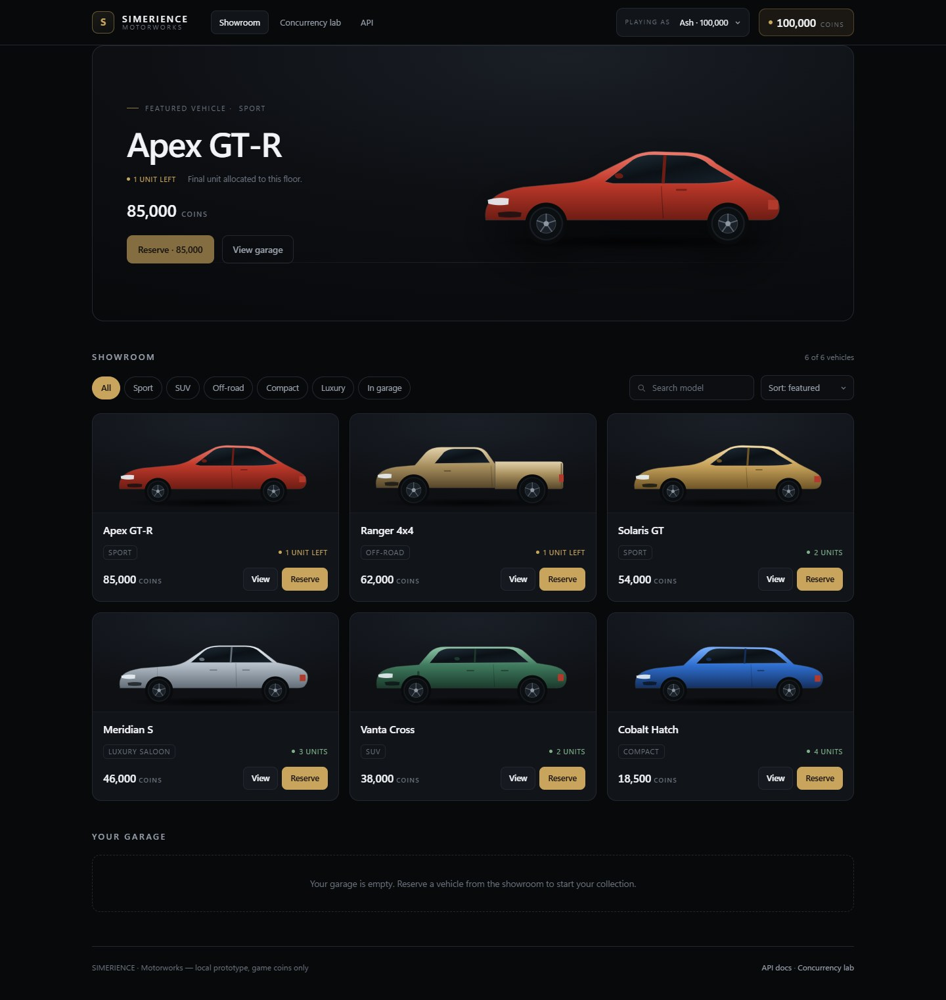
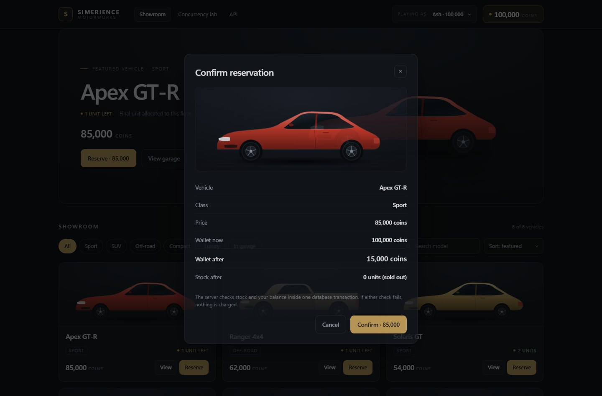
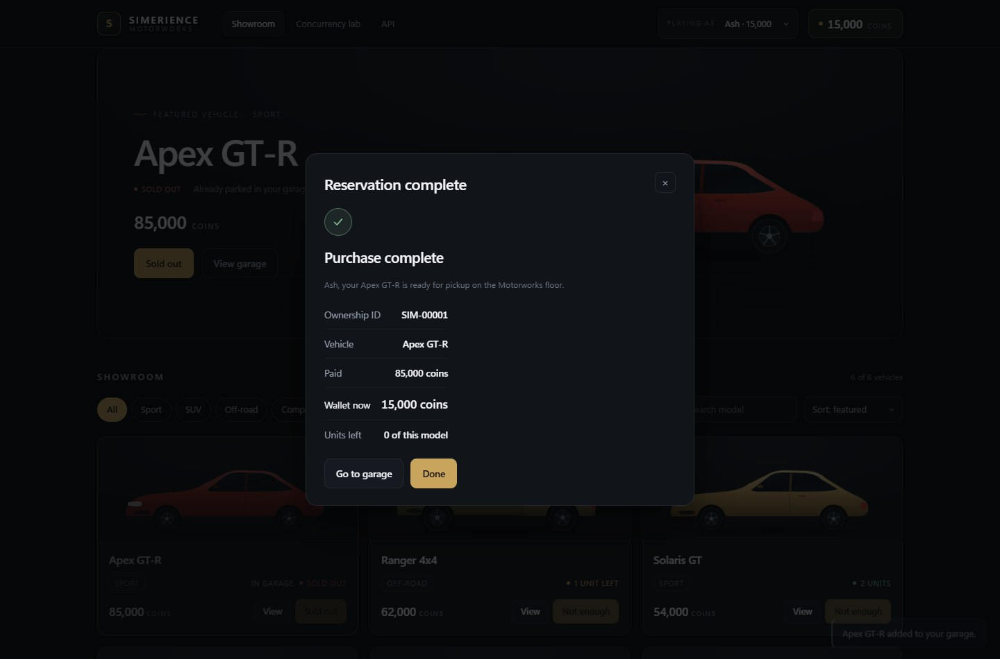
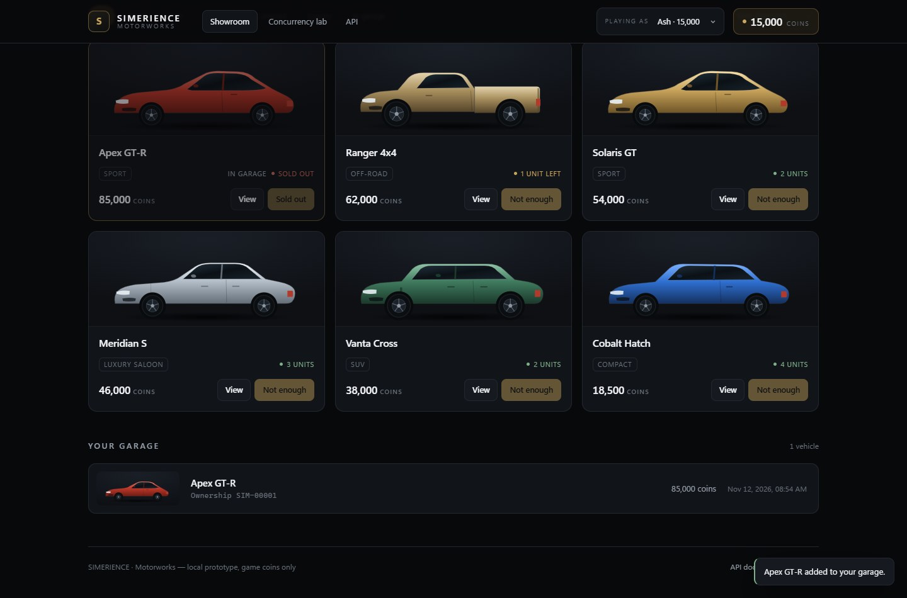
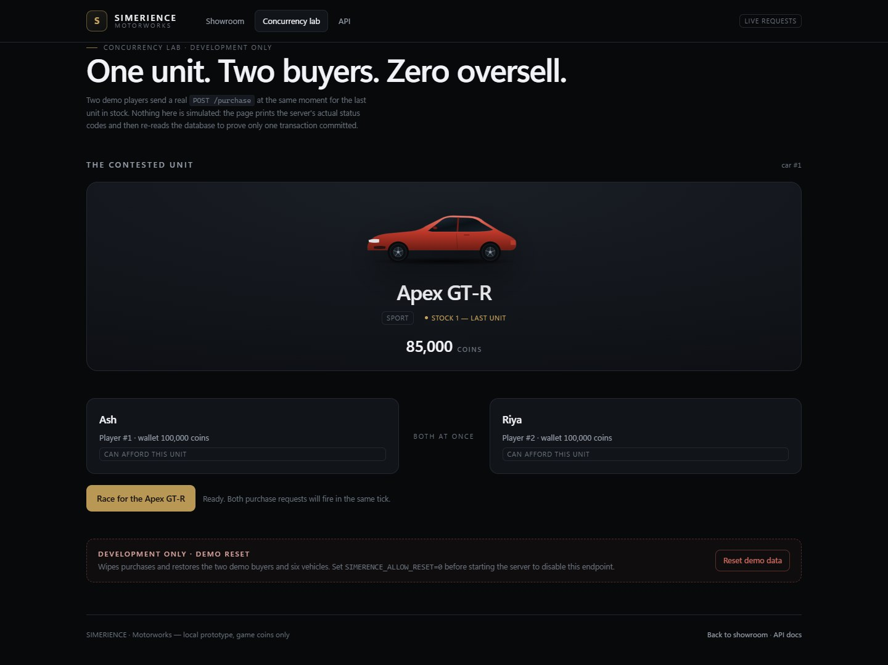
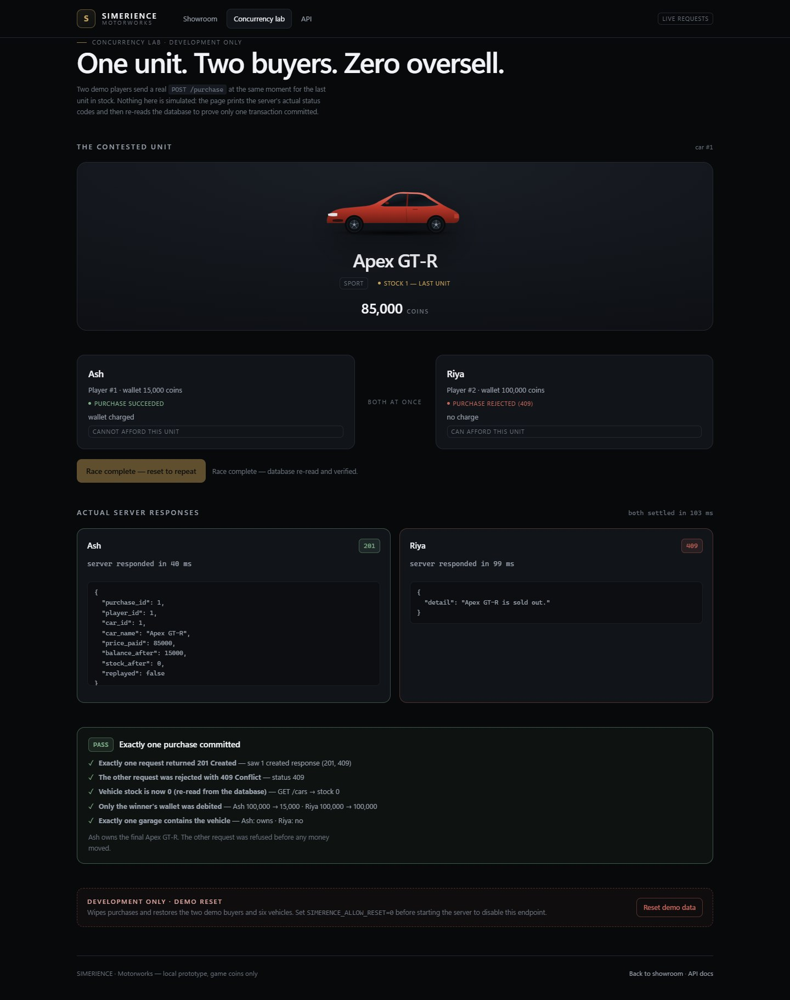
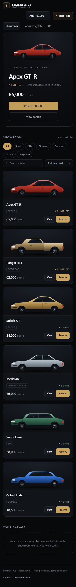

# SIMERIENCE — Motorworks

A car dealership feature for a life-simulation game, built as a working prototype.
A player has game coins, the floor has limited stock, and buying a car is
**atomic**: coins leave the wallet, stock drops, and the car lands in the garage —
all in one transaction, or not at all.

The backend is **Python + FastAPI + SQLite**. The front end is plain HTML, CSS and
JavaScript served by the same app — no framework, no build step, no npm. It is a
game-style showroom, not a SaaS dashboard.



---

## Run it

From the project folder (Windows PowerShell):

```powershell
cd path\to\simerience-car-purchase
python -m pip install -r requirements.txt
python seed.py --reset          # demo buyers + six vehicles, clean slate
python -m uvicorn main:app      # http://127.0.0.1:8000
```

Open **http://127.0.0.1:8000/** for the showroom,
**http://127.0.0.1:8000/race** for the concurrency lab, and
**http://127.0.0.1:8000/docs** for Swagger UI.

Stop the server with `Ctrl+C`.

Useful variations:

| Command | Effect |
|---|---|
| `python seed.py` | Adds demo data only if the tables are empty (keeps existing purchases) |
| `python seed.py --reset` | Wipes purchases, players and cars, then reseeds the demo state |
| `$env:SIMERENCE_ALLOW_RESET="0"` before uvicorn | Disables `POST /dev/reset` and the reset button (returns `403`) |
| `python -m pytest -v` | Runs the full test suite against a throwaway database |

The database is `simerience.db` in this folder and is created on first run.

---

## Two-minute demo script

| Time | What to do | What to point out |
|---|---|---|
| 0:00 | Open `http://127.0.0.1:8000/` | Featured **Apex GT-R**, 85,000 coins, **1 unit left**, Ash has 100,000 |
| 0:10 | Click **Sport**, then **All**; type `cobalt` in the search, then clear it | Filters, search and sort are live and only touch `/cars` |
| 0:20 | Click **Reserve · 85,000** on the hero | Confirmation modal: vehicle, class, price, **wallet now 100,000 → wallet after 15,000**, stock after |
| 0:35 | Click **Confirm · 85,000** | Real `POST /purchase`: receipt shows ownership ID **SIM-00001**, wallet 15,000, 0 units left; toast confirms |
| 0:50 | Click **Done**, then **Go to garage** / scroll down | Garage row with the ownership ID, price paid and timestamp; the hero is now **Sold out** |
| 1:00 | Switch **Playing as** to **Riya** | Riya still has 100,000; her garage is empty; the Apex is **Sold out** for everyone |
| 1:10 | Open **Concurrency lab** | One contested unit, two buyers, real `POST /purchase` requests |
| 1:20 | Click **Race for the Apex GT-R** | Two request cards show the actual status codes — one **201**, one **409** — with the raw JSON and timings |
| 1:35 | Read the verdict | **PASS**: exactly one 201, stock is 0, only the winner was debited, exactly one garage owns the car. Winner is whichever request committed first (it can be Ash or Riya) |
| 1:45 | Click **Reset demo data**, confirm | Development-only reset wipes purchases and restores 2 buyers / 6 vehicles; the showroom is back to 100,000 each |

Optional finish: set `SIMERENCE_ALLOW_RESET=0`, restart the server, and show that
the button now returns `403` — handy before handing the laptop to someone else.

---

## The showroom



- **Featured stage** with the largest vehicle on the floor, its class, stock and
  price. It follows the last vehicle you viewed.
- **Showroom grid** with class filters (Sport, SUV, Off-road, Compact, Luxury,
  In garage), text search, and sorting by price or stock.
- **Purchase modal** showing the vehicle, price, wallet before, wallet after and
  stock after the purchase. Wallet-after is computed client-side for the preview
  and labelled; the receipt uses the server's real `balance_after`.
- **Receipt** with the ownership ID, amount paid, remaining wallet and remaining
  stock, all taken from the `POST /purchase` response or a fresh read.
- **Garage** listing owned vehicles with `SIM-00001`-style ownership IDs, price paid
  and purchase timestamp (from `GET /players/{id}/garage`).
- Wallet, stock, affordability and garage refresh after every purchase; buttons
  disable themselves for sold-out or unaffordable vehicles; server errors are shown
  verbatim; loading skeletons and toasts cover slow and failed requests.
- Every visible control does something — there are no decorative buttons.





### Vehicle visuals — honest note

The cars are **original SVG side-profile illustrations**, generated in
`static/art.js`. They are **not photographs and not a licensed car library**.
Each model gets a body type, proportions and paint based on its name (for example
`Ranger 4x4` → pickup, `Vanta Cross` → SUV). This keeps the demo offline-friendly
and means nothing can 404.

The showroom only displays facts that exist in the database: name, price, stock
and purchase history. No horsepower, top speed, mileage or other invented specs.

---

## The concurrency lab

`/race` is a development page that proves the backend does not oversell, using the
real HTTP API rather than a simulation.

1. It picks a vehicle with `stock === 1` that both demo buyers can afford.
2. On **Race for the Apex GT-R**, it fires two `POST /purchase` calls in the same
   JavaScript tick with `Promise.all` and a fresh `Idempotency-Key` per request.
3. It prints each request's real status, duration and JSON body.
4. It then re-reads `/cars`, `/players/{id}` and `/players/{id}/garage` and checks:
   - exactly one request returned `201`;
   - the other returned `409 Conflict`;
   - the contested car's stock is now `0`;
   - only the winner's wallet was debited;
   - exactly one garage contains the vehicle.

The verdict is **PASS** only when every check holds. Nothing is hard-coded: if the
database disagreed, the page would show **FAIL** and the failing line.





> Seeing a red `409 (Conflict)` entry in the browser console on this page is
> expected — that is the losing purchase being rejected by the server. The request
> is handled in the UI; it is not an uncaught script error.

### Development reset

`POST /dev/reset` wipes purchases and restores the demo buyers and vehicles. It is
development-only, marked as such in the UI, and enabled by default for this local
prototype. Disable it with `SIMERENCE_ALLOW_RESET=0` before starting the server.



---

## API

| Method | Path | What it does |
|---|---|---|
| `GET` | `/` | Showroom page |
| `GET` | `/race` | Concurrency lab page |
| `POST` | `/dev/reset` | **DEV ONLY** — wipe and reseed demo data (403 if disabled) |
| `POST` | `/players` | Create a player with a starting balance (default 100,000) |
| `GET` | `/players` | List players |
| `GET` | `/players/{id}` | Balance |
| `GET` | `/players/{id}/garage` | Cars this player owns |
| `POST` | `/cars` | Add a car (name, price, stock) |
| `GET` | `/cars` | The shop, with remaining stock |
| `GET` | `/cars/{id}` | One car |
| `POST` | `/purchase` | Buy a car — requires an `Idempotency-Key` header |
| `GET` | `/health` | Liveness + database path |

Buy from the shell:

```powershell
$body = @{ player_id = 1; car_id = 2 } | ConvertTo-Json
Invoke-RestMethod -Method Post -Uri http://127.0.0.1:8000/purchase `
  -ContentType "application/json" -Headers @{ "Idempotency-Key" = "ash-buys-suv-001" } `
  -Body $body
```

Repeat the **same request with the same key** and the server returns the original
purchase with `"replayed": true` — no second charge.

---

## Why purchases cannot oversell

All purchase logic lives in `app/store.py` → `purchase_car()`.

```python
conn.execute("BEGIN IMMEDIATE")          # take the write lock before reading

replay = _existing_purchase(...)         # same key? return the stored result
player = ...                             # balance
car    = ...                             # price, stock

UPDATE players SET balance = balance - ? WHERE id = ? AND balance >= ?
UPDATE cars    SET stock   = stock - 1    WHERE id = ? AND stock > 0
INSERT INTO purchases (...)              # ownership + balance_after + stock_after
COMMIT
```

If either conditional `UPDATE` affects zero rows, the transaction rolls back, so
neither the wallet nor the stock moves. `BEGIN IMMEDIATE` closes the
read-then-write gap that causes double-selling. The `UNIQUE` idempotency key makes
retries and simultaneous duplicates safe, and `balance_after` / `stock_after` are
stored on the purchase row so a replay returns exactly the original result.

The naive failing version is in `tests/naive_oversell_demo.py`; the real
implementation is exercised by the test suite and by the race page.

---

## Tests

```powershell
python -m pytest -v
```

**22 passed** (the 16 original tests are unchanged; 6 were added). Full output:
[screenshots/pytest-output.txt](screenshots/pytest-output.txt).

New coverage:

- `tests/test_dev.py` — reset restores the demo dataset; reset is idempotent;
  reset clears purchases and refunds wallets; `SIMERENCE_ALLOW_RESET=0` returns
  `403`; `/race` and `static/race.js` are served and kept out of the OpenAPI paths;
  an HTTP-level simultaneous race produces exactly one `201` and one `409`, with
  one charged wallet and one garage entry.
- `tests/test_web.py` — unchanged showroom assertions still pass.
- `tests/conftest.py` — the test fixture now also resets SQLite sequences, so ids
  are predictable regardless of test order.

The race test uses `ThreadPoolExecutor` + a `threading.Barrier`; it releases both
requests together and asserts on their real status codes.

---

## Project layout

```
simerience-car-purchase/
├── app/
│   ├── db.py          # connection settings, schema, WAL + busy_timeout
│   ├── store.py       # business logic, the atomic purchase transaction
│   ├── schemas.py     # request/response models
│   ├── demo_data.py   # one source of demo players/cars for seed + reset
│   └── main.py        # FastAPI routes; serves /, /race and /static
├── static/
│   ├── index.html     # showroom
│   ├── race.html      # concurrency lab
│   ├── styles.css     # design system, responsive layout
│   ├── api.js         # shared fetch/format helpers
│   ├── art.js         # original SVG vehicle illustrations
│   ├── app.js         # showroom logic, modal, receipt, garage
│   ├── race.js        # real simultaneous purchases + verification
│   └── favicon.svg
├── tests/
│   ├── conftest.py               # throwaway DB per test run
│   ├── test_prototype.py         # original checklist tests + guards
│   ├── test_dev.py               # reset + race lab coverage (new)
│   ├── test_web.py               # pages and assets are served
│   └── naive_oversell_demo.py    # the bug this design prevents
├── main.py            # `uvicorn main:app` entry point
├── seed.py            # demo data (additive or --reset)
├── demo.py            # live race + retry transcript
└── screenshots/
```

---

## Limits of this prototype

- **Single process, single SQLite file.** Perfect for a local demo; a real
  multiplayer launch would use PostgreSQL and `SELECT ... FOR UPDATE`.
- **No authentication.** Anyone can act as any `player_id`. A real build takes the
  player from a login token.
- **`POST /cars` is open.** Fine for a prototype; it would be an admin endpoint.
- **No real money, refunds, taxes or production matchmaking.** Game coins only, and
  the race page is a concurrency demonstration rather than a multiplayer service.
- **The vehicle art is illustrative.** Original SVG silhouettes, not licensed
  manufacturer assets. Swapping in real art only requires replacing `carArt()`.
- **The reset endpoint is for development.** Keep `SIMERENCE_ALLOW_RESET=0` on any
  machine you hand to someone else.
- **Idempotency keys never expire.** Production would keep them for roughly a day.

The front end has no database access: it only calls the API, so stock, balance,
transaction and idempotency protections remain enforced in `app/store.py`.
