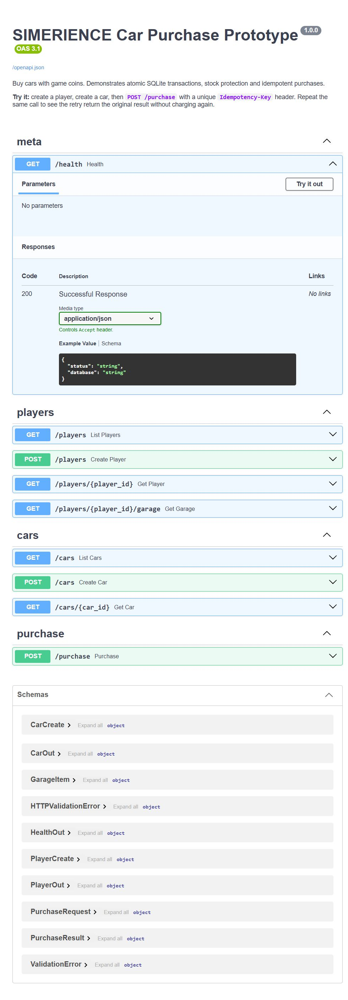
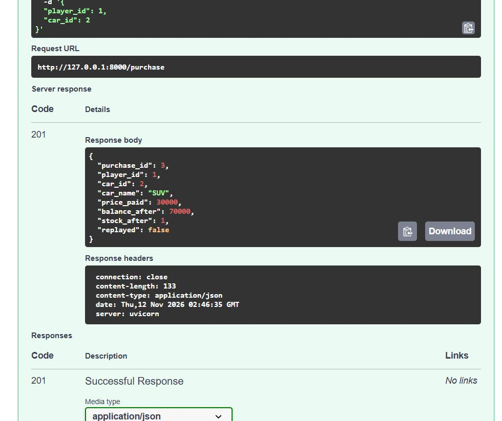

# SIMERIENCE — Car Purchase Prototype

A small, working backend for the car shop in SIMERIENCE. A player has game coins,
the shop has limited stock, and buying a car has to be **atomic**: coins leave the
wallet, stock goes down, and the car lands in the garage — all or nothing.

Built with **Python + FastAPI + SQLite**. No game engine, no real money, no cloud.



---

## What it proves

| # | Checklist item | Where it is proven |
|---|---|---|
| 1 | Player sees their balance and the available cars | `test_01_player_can_see_balance_and_shop` |
| 2 | Buying a car deducts the correct number of coins | `test_02_purchase_deducts_coins` |
| 3 | The purchased car appears in the garage | `test_03_car_appears_in_garage` |
| 4 | Restarting the server keeps the purchase | `test_04_purchase_survives_a_restart` |
| 5 | Insufficient balance deducts nothing | `test_05_insufficient_balance_changes_nothing` |
| 6 | Two players cannot buy the same last car | `test_06_only_one_player_wins_the_last_car`, `test_06b_no_oversell_under_heavy_concurrency` |
| 7 | Retrying the same request does not charge twice | `test_07_retry_with_same_key_is_not_charged_twice`, `test_07b_same_key_concurrent_requests_charge_once` |

13 tests, all passing (`python -m pytest -v`). Full output: [screenshots/pytest-output.txt](screenshots/pytest-output.txt).

---

## Run it

```bash
python -m pip install -r requirements.txt
python seed.py                 # demo players + cars
python -m uvicorn main:app --reload
```

Open **http://127.0.0.1:8000/docs** for Swagger UI and click *Try it out* on any endpoint.

> `seed.py --reset` deletes the database and starts over.

### Endpoints

| Method | Path | What it does |
|---|---|---|
| `POST` | `/players` | Create a player with a starting balance (default 100,000) |
| `GET` | `/players` | List players |
| `GET` | `/players/{id}` | Balance |
| `GET` | `/players/{id}/garage` | Cars this player owns |
| `POST` | `/cars` | Add a car (name, price, stock) |
| `GET` | `/cars` | The shop, with remaining stock |
| `GET` | `/cars/{id}` | One car |
| `POST` | `/purchase` | Buy a car — requires an `Idempotency-Key` header |
| `GET` | `/health` | Liveness + database path |

### Buy a car from the shell

```bash
curl -X POST http://127.0.0.1:8000/purchase \
  -H "Content-Type: application/json" \
  -H "Idempotency-Key: ash-buys-suv-001" \
  -d '{"player_id": 1, "car_id": 2}'
```

```powershell
# PowerShell
$body = @{ player_id = 1; car_id = 2 } | ConvertTo-Json
Invoke-RestMethod -Method Post -Uri http://127.0.0.1:8000/purchase `
  -ContentType "application/json" -Headers @{ "Idempotency-Key" = "ash-buys-suv-001" } `
  -Body $body
```

```json
{
  "purchase_id": 3,
  "player_id": 1,
  "car_id": 2,
  "car_name": "SUV",
  "price_paid": 30000,
  "balance_after": 70000,
  "stock_after": 1,
  "replayed": false
}
```

Run the **exact same request again** and you get the same `purchase_id` with
`"replayed": true` — the balance stays at 70,000.

| First purchase | Retry with the same key |
|---|---|
|  |  |

---

## How the purchase works

All of the interesting logic is one function in
[`app/store.py`](app/store.py): `purchase_car()`.

```python
conn.execute("BEGIN IMMEDIATE")          # take the write lock up front

# 1. already bought with this key? return the original result
replay = _existing_purchase(conn, idempotency_key, player_id, car_id)

# 2. read the current state (trustworthy: we hold the lock)
player = ...  # balance
car    = ...  # price, stock

# 3. conditional writes: the WHERE clause is the guard, rowcount is the proof
UPDATE players SET balance = balance - ? WHERE id = ? AND balance >= ?
UPDATE cars    SET stock   = stock - 1    WHERE id = ? AND stock > 0

# 4. record ownership in the same transaction
INSERT INTO purchases (...)
COMMIT
```

If any step fails we `ROLLBACK`, so the balance and the stock never move.

### Four rules, four mechanisms

| Rule | Mechanism |
|---|---|
| Atomic | One transaction — deduct, decrement and insert commit together or not at all |
| No oversell | `UPDATE cars SET stock = stock - 1 WHERE id = ? AND stock > 0` + `rowcount == 1` |
| No overdraft | `UPDATE players SET balance = balance - ? WHERE id = ? AND balance >= ?` + `rowcount == 1` |
| Idempotent | `idempotency_key` column with a `UNIQUE` constraint |

### Why `BEGIN IMMEDIATE`

`BEGIN IMMEDIATE` grabs the write lock *before* the reads. That closes the
read-then-write gap that causes double-selling:

```
Player A: SELECT stock -> 1                                 UPDATE stock -> 0
Player B:          SELECT stock -> 1    UPDATE stock -> 0
                                        ^ both thought the car was available
```

That naive version is in [`tests/naive_oversell_demo.py`](tests/naive_oversell_demo.py).
Run it and you get `stock: -1` — the same car sold to two players. The real
implementation serialises the writers, so the second one re-reads `stock = 0`
and gets a `409 Sold out`.

### Why an `Idempotency-Key`

Networks retry. A player taps *Buy*, the response is lost, the client retries —
without protection they pay twice. The key makes the operation safe to repeat:

- first call → charges, returns `replayed: false`
- later calls with the same key → returns the stored result, `replayed: true`
- same key for a *different* car → `409`, so a client bug can't silently
  return somebody else's purchase

The column is `UNIQUE`, which also covers two identical requests arriving at the
same moment: the loser hits the constraint, rolls back its own deductions, and
returns the winner's result.

### Database

```sql
players   (id, name UNIQUE, balance CHECK (balance >= 0), created_at)
cars      (id, name, price CHECK (price > 0), stock CHECK (stock >= 0))
purchases (id, player_id, car_id, price_paid, balance_after, stock_after,
           idempotency_key UNIQUE, created_at)
```

`balance_after` and `stock_after` are stored on the purchase row so a replay
returns exactly what the original call returned, even after later purchases.
Stock and balance also have `CHECK` constraints as a last line of defence.

---

## Demo script

With the server running:

```bash
python demo.py
```

It creates two players and a car with **1 in stock**, fires both purchases at the
same instant, then retries one purchase three times:

```
2) Both players press BUY at the same instant
  Ash buys the last car    409  {"detail": "Sports Car is sold out."}
  Riya buys the last car   201  {..., "balance_after": 50000, "stock_after": 0, "replayed": false}

4) Retry the same purchase request three times (same Idempotency-Key)
  attempt 1    201  {"purchase_id": 7, "balance_after": 70000, "replayed": false}
  attempt 2    201  {"purchase_id": 7, "balance_after": 70000, "replayed": true}
  attempt 3    201  {"purchase_id": 7, "balance_after": 70000, "replayed": true}
```

Full transcript: [screenshots/demo-output.txt](screenshots/demo-output.txt).

---

## Project layout

```
simerience-car-purchase/
├── app/
│   ├── db.py          # connection settings, schema, WAL + busy_timeout
│   ├── store.py       # business logic, the purchase transaction
│   ├── schemas.py     # request/response models
│   └── main.py        # FastAPI routes
├── tests/
│   ├── conftest.py               # throwaway database per test run
│   ├── test_prototype.py         # the 7 checklist tests + 6 extra guards
│   └── naive_oversell_demo.py    # the bug this design prevents
├── main.py            # `uvicorn main:app` entry point
├── seed.py            # demo players and cars
├── demo.py            # live race + retry demo
└── screenshots/
```

---

## Limits of this prototype

- **Single process, single file database.** SQLite serialises writers, which is
  perfect for a prototype and a single server. A real multiplayer launch would
  move to PostgreSQL and use `SELECT ... FOR UPDATE` for the same guarantees.
- **No authentication.** Anyone can buy as anyone; `player_id` comes from the
  request body. A real build takes the player id from a login token.
- **`POST /cars` is open.** Fine for a prototype; it would be an admin endpoint.
- **No money, no refunds, no taxes.** Game coins only.
- **Idempotency keys never expire.** Production would keep them for ~24h.

Next steps if this became real: auth, a `transactions` ledger, a `/refund`
endpoint with its own idempotency key, and Postgres.

---

## Publish to GitHub

```bash
git init
git add .
git commit -m "SIMERIENCE car purchase prototype: atomic SQLite transactions + idempotent purchases"
git branch -M main
git remote add origin https://github.com/<your-username>/simerience-car-purchase-prototype.git
git push -u origin main
```

`*.db`, `__pycache__` and `.pytest_cache` are gitignored; the screenshots are not.
